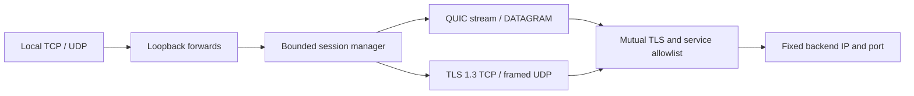

# Architecture

The Go core and pre-existing Python WireGuard/udp2raw installer are independent. No automatic migration exists.

Each TCP connection and UDP source-address association owns one transport connection. This isolates flow state but increases handshake, CPU and memory overhead. Pooling and cross-flow multiplexing are not implemented. UDP has a 32-packet outbound queue per association; idle associations expire. Payloads above 1150 bytes are dropped and counted; there is no custom fragmentation. This conservative limit is not discovered PMTU. TCP uses bounded 32 KiB copy buffers, half-close and inactivity deadlines.

QUIC congestion control, packet protection, PMTU behavior and loss recovery come from quic-go. QUIC early data is disabled. TLS 1.3 uses a dedicated CA and explicit client identity. ALPN `nextgen-tunnel/1` and application framing are identifiable, not HTTP/3, MASQUE, Hysteria or browser camouflage.

Requests name an installed service and protocol, never an arbitrary target. Endpoint and backend addresses are literal IPs; TLS identity uses `server_name` independently. Local listeners bind only to loopback. No DNS resolution, proxy discovery or hidden network reconfiguration occurs.

Health checks echo a random 32-byte nonce through a new authenticated connection. They test transport reachability and application response, not every backend or existing session. Two successes make a path ready; three failures mark it down. Failed paths use bounded 2/4/8/16/32-second backoff plus jitter. Endpoint order sets initial preference. A working selected path remains selected without opportunistic failback. Backend rejection does not mark transport health down. Application bytes are never replayed.

Native failover applies to new TCP connections and UDP associations. Existing sessions can fail and do not migrate. The core has no multipath, TUN, DNS interception or host route manipulation. The optional external engine adds a separately owned dual-stack TUN namespace, proxied DNS and Hysteria2/REALITY selection. WireGuard site namespaces provide genuine L3 routes over a loopback carrier. Those components require explicit privileged lifecycle operations; they do not turn the native installer into an integrated site installer. See [engine/site operation](engine-site.md) and [current acceptance status](STATUS.md). The old WireGuard agent has separate behavior.

Status is local atomic JSON, containing counters, selected path and probe state without keys or payloads. There is no remote management API.
